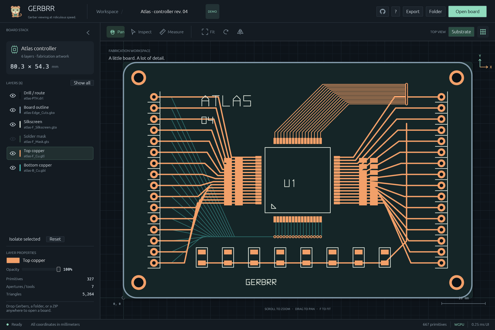

<div align="center">
  
  <h1>Gerbrr</h1>
  <p><strong>Gerber viewing at ridiculous speed.</strong></p>
  <p>A fast, local-first Gerber viewer. Native desktop. Same workspace in your browser.<br>Warm copper, quiet chrome, and a gerbil who takes eye protection seriously.</p>
  <p><a href="https://gerbrr.bndnsmth.com/">Try Gerbrr →</a> · <a href="#download">Download</a> · <a href="#build-from-source">Build locally</a> · <a href="GUIDE.md">User guide</a></p>
</div>



<p align="center"><sub>The built-in Atlas board, captured in the actual native app.</sub></p>

## Less waiting. More board.

- **Drop it in.** Open Gerber and Excellon files, folders, or ZIPs—no unpacking required.
- **Move fast.** GPU-accelerated pan and zoom, rotation, back-side mirroring, and cached rendering.
- **See what matters.** Isolate layers, tune colors and opacity, or collapse the sidebar for more canvas.
- **Measure cleanly.** Snap to pad and hole centers, slot endpoints, and geometry edges. Hold `Alt` for a free point.
- **Keep it yours.** Board files stay on your machine, including in the browser. No uploads, accounts, or analytics.
- **Share the view.** Export a workspace PNG, or inspect fabrication files from the command line.

Built with **Rust · egui · wgpu**. Tested against [eight real KiCad, Altium, and Cadence designs](CORPUS.md).

## Get started

**[Open Gerbrr in your browser →](https://gerbrr.bndnsmth.com/)** No installation. Your boards stay local.

### Download

**[Get the latest desktop release →](https://github.com/bndnsmth/gerbrr/releases/latest)** No Rust or Node installation needed.

| Your computer | Archive ending in |
| --- | --- |
| Linux x86-64, glibc 2.35+ | `linux-x86_64.tar.gz` |
| Windows x86-64 | `windows-x86_64.zip` |
| macOS 13+, Apple Silicon | `macos-arm64.zip` |
| macOS 13+, Intel | `macos-x86_64.zip` |

Extract the archive, then:

- **Linux:** run `./gerbrr` from the extracted folder. Desktop graphics libraries and a compatible driver are required.
- **Windows:** open `gerbrr.exe`. Builds are unsigned; if SmartScreen blocks a trusted release download, choose **More info → Run anyway**.
- **macOS:** move **Gerbrr.app** to Applications and open it. Builds are ad-hoc signed, not Apple-notarized. If macOS cannot verify the app, dismiss the warning, then choose **System Settings → Privacy & Security → Open Anyway** and confirm **Open**.

Only approve downloads you trust; no system-wide security changes are needed.
Each package includes license notices, and each release includes `SHA256SUMS` for archive verification.

### Build from source

Build from source with [mise](https://mise.jdx.dev/); Rust and Node versions are pinned for you.

```sh
git clone https://github.com/bndnsmth/gerbrr.git
cd gerbrr
mise trust
mise install
```

**Desktop**

```sh
mise run dev
```

**Browser proof of concept**

```sh
mise run web
```

Open **[localhost:4173](http://localhost:4173)**. Both versions start with the Atlas
demo—drop your board ZIP or choose **Open board** to view your own design.

Desktop apps require a desktop session and compatible graphics driver.
The browser needs **WebGPU or WebGL2**; desktop-sized windows
are recommended. [Browser details →](WEB.md)
Small screens show a desktop-first notice with **Continue anyway**; mobile layout support is still to come.

### Prefer a terminal?

The desktop download includes the CLI. From an extracted Linux package:

```sh
./gerbrr open board.zip
./gerbrr inspect board.zip
./gerbrr screenshot board.png board.zip
```

On Windows use `.\gerbrr.exe`; on macOS use `./Gerbrr.app/Contents/MacOS/gerbrr`.
For a source build, use `./target/release/gerbrr` instead.

### A few keys go a long way

| Action | Shortcut |
| --- | --- |
| Fit the board | `F` |
| Pan anywhere | `Space` + drag |
| Inspect / measure | `V` / `M` |
| Toggle snapping / place a free point | `N` / hold `Alt` |
| Rotate / mirror | `R` / `B` |
| Isolate selected layer | `S` |
| All shortcuts | `?` |

## A viewer, not a manufacturing sign-off tool

Gerbrr supports RS-274X/X2 Gerber and Excellon, but not every format extension.
Review import warnings. The substrate is a decorative bounds rectangle, not a
reconstructed board outline; snapping is not a clearance check or manufacturing DRC.
[Format coverage and limitations →](GUIDE.md#format-coverage-and-limitations)

## Make it better

Found a tricky export? [Open an issue](https://github.com/bndnsmth/gerbrr/issues)
with what you expected, what happened, and a small sample **if you can share it**.
For code changes, run `mise run check` before submitting a pull request.

[User guide](GUIDE.md) · [Browser architecture](WEB.md) · [Deployment](DEPLOY.md) · [Releases](RELEASING.md) · [Performance notes](PERFORMANCE.md) · [Regression corpus](CORPUS.md)

[MIT licensed](LICENSE). Dependencies and [third-party assets](assets/README.md) retain their respective licenses.
